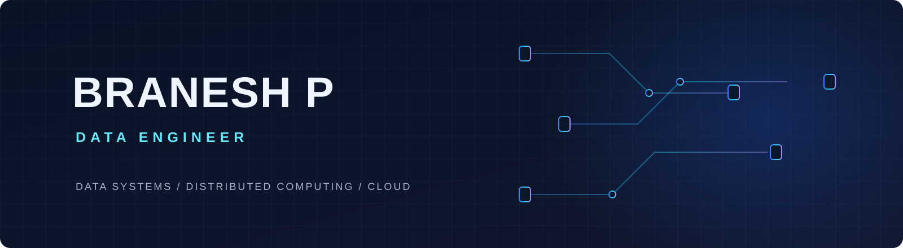

  

  

  <samp>data flows in &nbsp;→&nbsp; understanding flows out</samp>

---

## A little about me

Hey, I'm Branesh, based in India. I like exploring how data moves through systems—from processing and distributed computing to cloud platforms. I'm curious about what happens under the hood, and I learn best by building things and experimenting.

## Things I work with

**Programming · SQL**

  

**Data engineering · Spark · PySpark · Airflow · Pandas · Delta Lake**

  
  &nbsp;&nbsp;
  
  &nbsp;&nbsp;
  
  &nbsp;&nbsp;
  Delta Lake

**Cloud · AWS**

  

**Tools · Docker · Git · GitHub Actions · Terraform**

  

---

## Around the contribution graph

The GitHub contribution graph lives just below this README. Here's its little snake counterpart:

<picture>
  <source media="(prefers-color-scheme: dark)" srcset="https://raw.githubusercontent.com/branesh2k/branesh2k/output/github-snake-dark.svg">
  
</picture>

---

## Say hello

  
  &nbsp;
  
  &nbsp;
  

